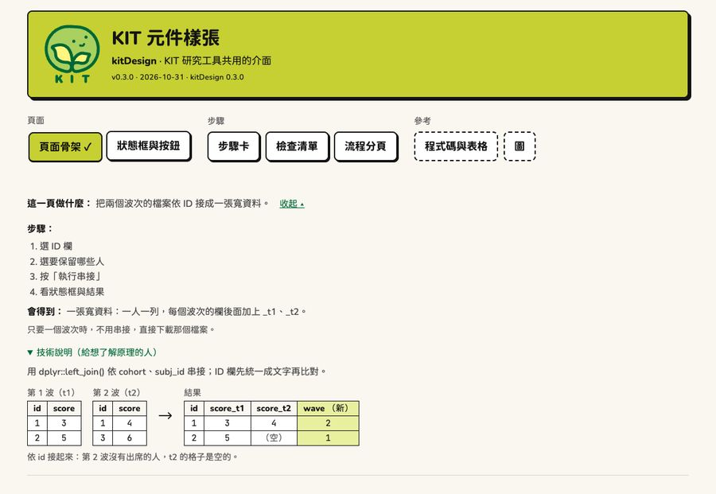
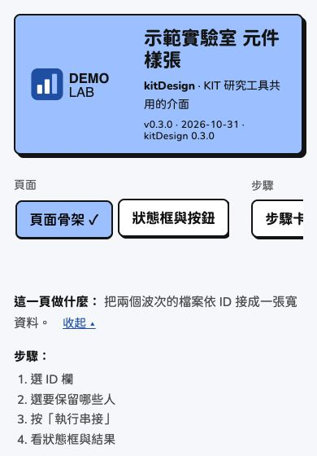

# 換成別的品牌

kitDesign 預設是 KIT 的樣子：萊姆色的頁首、KIT
綠的連結、豆子標誌。別的計畫或研究室要用時，
**只換標誌與顏色**；字型、框、陰影、元件、文案規則照[設計語言](https://jiewentsai.github.io/kitDesign/articles/design-language.md)。
（kitDesign 0.3.0 起）

## KIT 與示範品牌

上面是 KIT，下面是藍色系的示範品牌：




手機（390px 寬）：



在自己的電腦上看：`kit_gallery(brand = "demo")`。

## 設定一次，整個 app 都用

在 app 開始時（例如 `app.R` 的最上面，或 `run_app()` 裡）：

``` r

options(kitDesign.brand = kit_brand(
  "示範實驗室",
  logo = "logo.svg",     # 頁首的標誌：SVG 或 PNG
  mark = "mark.svg",     # 瀏覽器分頁的小圖示（方形）；沒有給時用 logo
  colors = list(accent = "#9cc0ff", primary = "#1f4fa3", page = "#f5f7fa")
))
```

之後
[`kit_page()`](https://jiewentsai.github.io/kitDesign/reference/kit_page.md)、[`kit_header()`](https://jiewentsai.github.io/kitDesign/reference/kit_header.md)、[`kit_theme()`](https://jiewentsai.github.io/kitDesign/reference/kit_theme.md)、[`kit_colors()`](https://jiewentsai.github.io/kitDesign/reference/kit_colors.md)、[`kit_chart_sequential()`](https://jiewentsai.github.io/kitDesign/reference/kit_chart_sequential.md)、
[`kit_plotly_style()`](https://jiewentsai.github.io/kitDesign/reference/kit_plotly_style.md)
都用這個品牌。只給一頁時：`kit_page(..., brand = kit_brand(...))`。

[`kit_brand()`](https://jiewentsai.github.io/kitDesign/reference/kit_brand.md)
不給參數就是 KIT，畫出來的頁面和以前一模一樣。

``` r

kit_brand("示範實驗室", colors = list(accent = "#9cc0ff", primary = "#1f4fa3"))
#> <kit_brand> 示範實驗室
#>   logo: none  (alt: 示範實驗室 標誌)
#>   mark: none
#>   colors (* = not KIT):
#>     ink            #141414
#>     page           #faf7f0
#>     card           #ffffff
#>     accent         #9cc0ff  *
#>     accent_light   #d4e2ff  *
#>     primary        #1f4fa3  *
#>     primary_hover  #1f3b77  *
#>     success        #b9f0a8
#>     warning        #ffde59
#>     danger         #ff9b8f
#>     info           #a8dcff
```

## 可以換的顏色

| 名稱 | CSS 變數 | KIT | 用在 |
|----|----|----|----|
| `accent` | `--nb-lime` | `#c6d033` | 主角色塊：頁首、主要按鈕、目前的分頁 |
| `accent_light` | `--nb-bg-new` | `#e8f0a0` | 淡的主角色：圖解裡新加的欄、色階的淡端 |
| `primary` | `--nb-green` | `#006835` | 連結、勾選框、進度條、色階的深端 |
| `primary_hover` | `--nb-green-hover` | `#004d27` | 連結滑過 |
| `ink` | `--nb-ink` | `#141414` | 文字、框、陰影 |
| `page` | `--nb-page` | `#faf7f0` | 整頁背景 |
| `card` | `--nb-card` | `#ffffff` | 卡片、輸入框、表格 |
| `success` | `--nb-mint` | `#b9f0a8` | 【完成】 |
| `warning` | `--nb-yellow` | `#ffde59` | 【完成，但請注意】 |
| `danger` | `--nb-salmon` | `#ff9b8f` | 【停下來】、危險按鈕 |
| `info` | `--nb-sky` | `#a8dcff` | 資訊提示框 |

- 通常只要換 `accent` 與 `primary`。只給 `accent` 時，`accent_light`
  自動算；只給 `primary` 時， `primary_hover` 自動算。
- 寫錯名稱會停下來，列出可以用的名稱。
- 色塊上的字一律是 `ink`：`accent` 與四個狀態色上面放 `ink`
  要夠清楚（對比至少 4.5:1）； `primary` 是連結的字，在 `page` 上也要
  4.5:1。
- 四個狀態色最好不換；換的話，意思不能變（完成、要注意、停下來、資訊）。
- 灰色、焦點框、圖的類別色（Okabe–Ito，色盲友善）不跟著換。

## 標誌

- `logo`：頁首的完整標誌，高度固定（電腦 5.6rem、手機
  3.6rem），寬度跟著比例。
- `mark`：瀏覽器分頁的小圖示，方形，SVG 最清楚。
- 檔案在
  [`kit_brand()`](https://jiewentsai.github.io/kitDesign/reference/kit_brand.md)
  時讀進來；在 Shiny 裡由一個只有這兩個檔的 dependency 提供
  （不會公開檔案所在的資料夾）。不用 Shiny 的單一 HTML 檔用
  `kit_header(logo = "inline")`。
- 替代文字預設是「\<名稱\> 標誌」，用 `logo_alt =`
  改。沒有標誌：`logo = FALSE`。

## 圖的色階

熱圖的色階跟著品牌：極淡的 `accent_light` → `accent_light` → `primary`。

``` r

kit_chart_sequential(kit_brand("示範", colors = list(accent = "#9cc0ff", primary = "#1f4fa3")))
#> [[1]]
#> [[1]][[1]]
#> [1] 0
#> 
#> [[1]][[2]]
#> [1] "#EBF1FF"
#> 
#> 
#> [[2]]
#> [[2]][[1]]
#> [1] 0.2
#> 
#> [[2]][[2]]
#> [1] "#D4E2FF"
#> 
#> 
#> [[3]]
#> [[3]][[1]]
#> [1] 0.4
#> 
#> [[3]][[2]]
#> [1] "#ABBAE7"
#> 
#> 
#> [[4]]
#> [[4]][[1]]
#> [1] 0.6
#> 
#> [[4]][[2]]
#> [1] "#8394D0"
#> 
#> 
#> [[5]]
#> [[5]][[1]]
#> [1] 0.8
#> 
#> [[5]][[2]]
#> [1] "#5770B9"
#> 
#> 
#> [[6]]
#> [[6]][[1]]
#> [1] 1
#> 
#> [[6]][[2]]
#> [1] "#1F4FA3"
```
