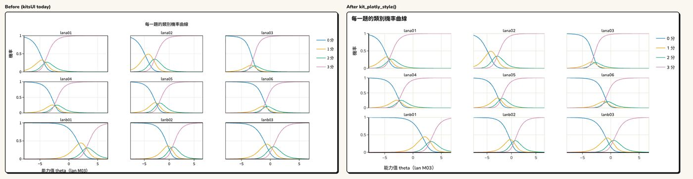
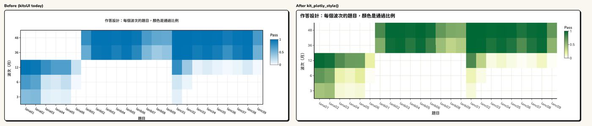
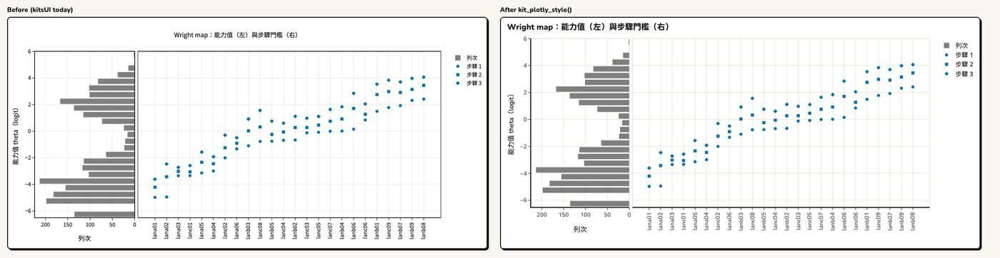
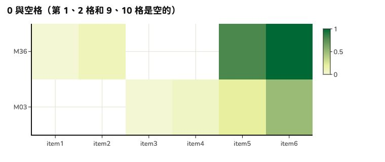

```{r setup, include = FALSE}
knitr::opts_chunk$set(collapse = TRUE, comment = "#>", eval = FALSE)
```

kits 畫好的 plotly 圖（例如 `plot(item, type = "category")`），最後交給 `kit_plotly_style()`：
字型、軸線、格線、底色、標題、圖例、色條、滑過的說明框、工具列都換成 KIT 的樣子。
**只改樣子，不改資料**：點、線、軸的範圍、刻度、hover 的文字都不動。

## 前後對照

左邊是原來的圖，右邊是 `kit_plotly_style()` 以後。

**類別機率曲線**（並排的小圖：每個小圖外面的黑框換成淡線，框裡面不再有框）



**作答設計圖**（熱圖：換成 KIT 的色階）



**Wright map**



熱圖的最小值不是白色：0% 和沒有施測（空白）的格子分得開。



## 怎麼用

```{r}
library(kitDesign)

p <- plotly::plot_ly(d, x = ~wave, y = ~score, split = ~cohort,
                     type = "scatter", mode = "lines+markers")
p <- plotly::layout(p, title = "各世代的分數中位數")
kit_plotly_style(p)
```

## 和 kits、kitsUI 一起用：順序

1. kits 的 `plot()` 畫圖。
2. kitsUI 換色：`kit_chart_categorical()`、`kit_chart_role()`。
3. kitsUI 換中文：`kit_chart_zh()`。**一定要在 `kit_plotly_style()` 前面**：
   `kit_plotly_style()` 會把標題加粗（`<b>`），之後就認不得原來的英文標題了。
4. 最後 `kit_plotly_style()`。

```{r}
p <- plot(item, type = "category")              # 1. kits
p <- kit_chart_zh(kit_chart_categorical(p))     # 2–3. kitsUI：換色、換中文
kit_plotly_style(p)                             # 4. 最後
```

同一張圖套兩次和套一次一樣。kits 或 kitsUI 指定的顏色不動；只有 plotly 自己給的預設色
換成 Okabe–Ito（色盲友善）。

## 常用的選項

| 參數 | 做什麼 |
|---|---|
| `legend = "auto"` | 圖例超過 4 項或太長、或圖寬小於 600px（手機）時放到下面；`"bottom"`、`"right"`、`"keep"` |
| `colorscale = FALSE` | 熱圖保留原來的色階 |
| `filename = "kit-chart"` | 工具列「下載成 PNG」的檔名 |
| `font_size = 15` | 內文字級（px），其他字級跟著算 |
| `brand = ` | 熱圖的色階跟著品牌換（見[換成別的品牌](brand.html)） |

顏色：類別色 `kit_chart_colors()`、參考線 `kit_chart_neutral()`、連續的值 `kit_chart_sequential()`。
