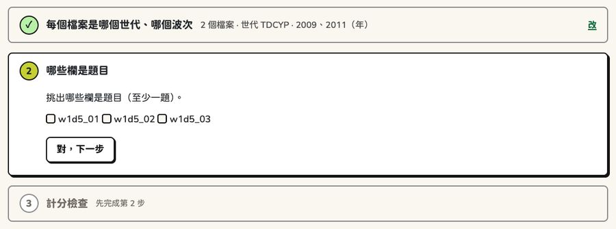
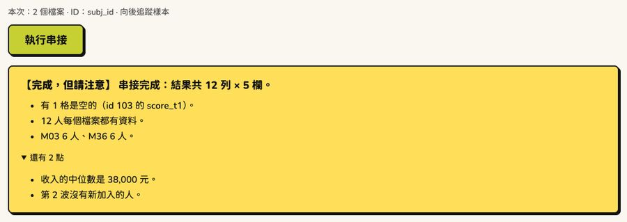
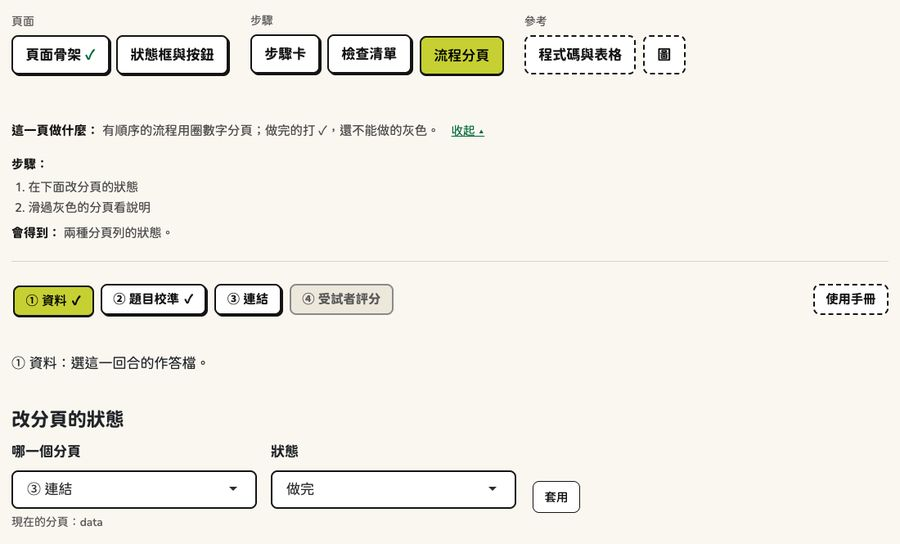
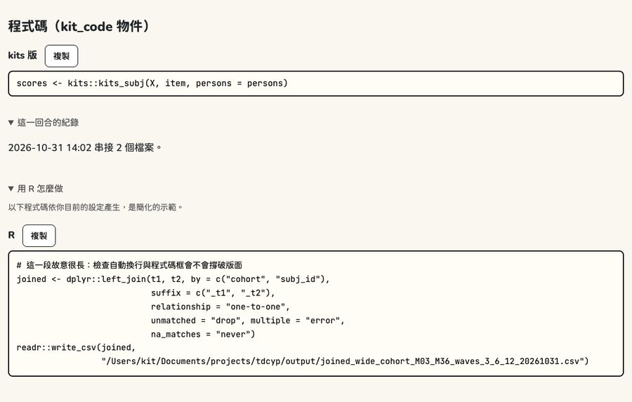

```{r setup, include = FALSE}
knitr::opts_chunk$set(collapse = TRUE, comment = "#>")
library(shiny)
library(kitDesign)
# 值物件（狀態框、檢查清單、程式碼）在文件裡也畫成 HTML
for (cls in c("kit_status", "kit_check", "kit_checklist", "kit_code")) {
  registerS3method("knit_print", cls, function(x, ...) knitr::knit_print(htmltools::as.tags(x), ...),
                   envir = asNamespace("knitr"))
}
```

```{r kit-css, echo = FALSE}
# 這一頁載入 kitDesign 自己的樣式：下面的元件是真的畫出來的，不是截圖
htmltools::tagList(use_kit())
```

這一頁的元件都是用 kitDesign 直接畫出來的：每一段先是 R 程式碼，下面就是它的樣子。
規格（什麼時候用、不要怎麼用）在[設計語言](design-language.html)；在自己的電腦上看所有元件：
`kitDesign::kit_gallery()`。

按鈕、收合這些在 Shiny 裡才會動的地方，這裡只看樣子。有狀態的元件（模組）放在最後，用截圖。

## 頁首（Header）

一個 app 只有一個，放在最上面：標誌、工具名稱、副標、版本行。`kit_page()` 已經放好了。

::: {.kit-live}
```{r}
kit_header(
  "KIT 資料串接工具", "臺灣幼兒發展調查資料庫", tagline = "跨波次資料處理",
  version = "0.5.0", date = "2026-10-31",
  logo = "inline"   # 在 Shiny 裡用預設的 TRUE；這裡是靜態網頁，所以把標誌寫進頁面
)
```
:::

## 步驟分頁（NavTabs）

分組、不編號的分頁列（kitJoin 的樣子）。目前的分頁是萊姆色；虛線框是「工具」組。

::: {.kit-live}
```{r}
kit_navgroups(list(
  kit_navgroup("準備", c(upload = "檔案上傳", missing = "遺漏值處理")),
  kit_navgroup("做出資料", c(join = "串接", kits = "轉成 kits 作答檔")),
  kit_navgroup("其他工具", c(manual = "使用手冊"), tools = TRUE)
), tabset = "tabs", selected = "join")
```
:::

## 頁面說明：這一頁做什麼（PageGuide）

每一頁最上面一句話，旁邊「看步驟 ▸」；步驟與會得到什麼預設收起。

::: {.kit-live}
```{r}
kit_tab_guide(
  goal = "把兩個波次的檔案依 ID 接成一張寬資料。",
  steps = c("選 ID 欄", "選要保留哪些人", "按「執行串接」", "看狀態框與結果"),
  output = "一張寬資料：一人一列。"
)
```
:::

## 按鈕（Button）

一頁只有一個主要按鈕（萊姆色）。小按鈕給下載、全選；危險按鈕是鮭魚色。停用的按鈕是灰的，
上面一定寫「還差：…」。

::: {.kit-live}
```{r}
tags$div(
  style = "display: flex; flex-wrap: wrap; align-items: center; gap: 0.6rem 1rem;",
  kit_button("run", "開始校準", "primary"),
  kit_button("csv", "下載 CSV"),
  kit_button("skip", "這一回合不做", "danger"),
  kit_button("convert", "執行轉換", "primary", disabled = TRUE)
)
```
:::

## 狀態框（StatusBox）

按了主要按鈕以後第一眼看的框，只有四種：【完成】【完成，但請注意】【停下來】【要重新執行】。
第一行是一句結論，下面最多 3 點，其他收起來。

::: {.kit-live}
```{r}
kit_done_status("串接完成：結果共 3,389 列 × 2,058 欄。",
                points = c("688 人每個檔案都有資料。", "第 1 波 3,389 人，第 2 波 3,102 人。"))
```
:::

::: {.kit-live}
```{r}
kit_done_status(
  "串接完成：結果共 3,389 列 × 2,058 欄。",
  warnings = c("有 12 人的 ID 重複，只留第一筆。", "第 3 波沒有 sex 欄。")
)
```
:::

::: {.kit-live}
```{r}
kit_error_status(simpleError("object 'subj_id' not found"), "串接")
```
:::

::: {.kit-live}
```{r}
kit_stale_status("執行串接")
```
:::

## 提示框（Callout）

資訊是天藍色，要注意是黃色。提示框不是結果，所以沒有陰影。

::: {.kit-live}
```{r}
kit_callout("外部連結不適用：這一回合只有一個世代，這不是錯誤。")
kit_callout("資料裡有疑似遺漏值代碼，建議先到「遺漏值處理」。", warn = TRUE)
```
:::

## 資料表（DataTable）

表格寬度跟著內容；太寬時在自己的框裡左右捲。上面一行小字寫共幾列幾欄。

::: {.kit-live}
```{r}
waves <- data.frame(
  id = 101:105, cohort = c("M03", "M36", "M03", "M36", "M03"), wave_m = c(3, 6, 12, 3, 6),
  income = c(32000, 45500, 28750, 51200, 39900)
)
tagList(
  tags$p(class = "kit-hint", kit_rows_note(120, ncol(waves), shown_rows = 5)),
  kit_table_scroll(kit_static_table(waves))
)
```
:::

## 圖（Chart）

plotly 圖最後交給 `kit_plotly_style()`：字型、軸線、圖例、工具列和 app 一致。
前後對照與用法見[「圖」](charts.html)。類別色用色盲友善的 Okabe–Ito：

::: {.kit-live}
```{r}
swatch <- function(col, name) {
  tags$div(
    tags$div(style = paste0("width: 4rem; height: 2rem; border: 2px solid var(--nb-ink); ",
                            "border-radius: 8px; background: ", col)),
    tags$small(class = "kit-hint", name)
  )
}
cols <- kit_chart_colors()
tags$div(style = "display: flex; flex-wrap: wrap; gap: 0.6rem;",
         Map(swatch, cols, names(cols)), swatch(kit_chart_neutral(), "neutral"))
```
:::

## 細節列（Details）

結果下面一排收起來的細節：紀錄、檢查表、用 R 怎麼做。要看再打開。

::: {.kit-live}
```{r}
kit_details_row(
  kit_detail("這一回合的紀錄", tags$p("2026-10-31 14:02 串接 2 個檔案。")),
  kit_detail("用 R 怎麼做", kit_code("joined <- dplyr::left_join(t1, t2, by = \"subj_id\")"))
)
```
:::

進階設定（預設收起）與設定摘要：

::: {.kit-live}
```{r}
tagList(
  kit_advanced(checkboxInput("trim", "比對前去掉 ID 前後的空白", TRUE)),
  kit_settings_line(c("2 個檔案", "ID：subj_id", "向後追蹤樣本"))
)
```
:::

## 用 R 怎麼做（CodePanel）

一個版本的程式碼：每行最多 70 欄（太長自動換行），旁邊有「複製」。

::: {.kit-live}
```{r}
kit_code(
  "scores <- kits::kits_subj(X, item, persons = persons, method = \"WLE\", se = TRUE, theta_range = c(-6, 6))",
  "kits 版"
)
```
:::

## 步驟卡（StepCard）

一次做一步：現在這一步有框和陰影，做完的收成一行摘要（「改」可以回去），還不能做的是灰的。

::: {.kit-live}
```{r}
tagList(
  kit_step_card(kit_step_head(1, "每個檔案是哪個世代、哪個波次", "done",
                              summary = "2 個檔案 · 世代 TDCYP", edit_id = "edit1")),
  kit_step_card(
    kit_step_head(2, "哪些欄是題目", "current", title_id = "st2"),
    kit_step_body(tags$p("挑出哪些欄是題目（至少一題）。"), actionButton("ok2", "對，下一步")),
    title_id = "st2"
  ),
  kit_step_card(kit_step_head(3, "計分檢查", "locked"))
)
```
:::

## 檢查清單（Checklist）

轉換前要看的事：! 要決定（旁邊有按鈕）、✓ 沒問題、i 提醒。

::: {.kit-live}
```{r}
kit_checklist(
  kit_check("todo", "有 3 題的分數從 1 開始", "kits 要的分數是 0、1、2…。可以全部減 1，或照原樣。",
            actions = list(kit_button("shift", "全部減 1（建議）"), kit_button("keep", "照原樣"))),
  kit_check("ok", "45 題的分數都是整數"),
  kit_check("note", "有 2 題沒有人作答，不會放進作答檔")
)
```
:::

## 還差什麼（ReadyLine）

主要按鈕還不能按時，上面一行寫還差什麼，旁邊一個連結帶使用者去補。

::: {.kit-live}
```{r}
tagList(
  kit_ready_line("至少要 2 個波次的檔案，目前只有 1 個",
                 actionLink("goto_upload", "到「檔案上傳」加入檔案 →")),
  kit_button("join", "執行串接", "primary", disabled = TRUE)
)
```
:::

## 下一步（NextStep）

做完一頁，最下面告訴使用者接著去哪裡。

::: {.kit-live}
```{r}
kit_next_step("串接好了。接著把資料轉成 kits 作答檔。", "next", "下一步：轉成作答檔")
```
:::

## 圖解（Diagram）

處理前的小表 → 處理後的小表。新加的欄是淡萊姆色，欄名後面寫「（新）」。

::: {.kit-live}
```{r}
kit_diagram(
  list(kit_dg_table(data.frame(id = 1:2, score = c(3, 5)), "第 1 波（t1）"),
       kit_dg_table(data.frame(id = c(1, 3), score = c(4, 6)), "第 2 波（t2）")),
  kit_dg_table(data.frame(id = 1:2, score_t1 = c(3, 5), score_t2 = c(4, NA), wave = c(2, 1)),
               "結果", added = "wave"),
  "依 id 接起來：第 2 波沒有出席的人，t2 的格子是空的。"
)
```
:::

## 模組（有狀態的元件）

下面四個元件要在 Shiny 裡才會動（哪一步打開、按鈕能不能按、分頁的 ✓），
所以用截圖。每一個都是一頁一行：`*_ui(id)` 放在頁面，`*_server(id)` 放在 server。

**步驟卡**：`kit_stepcards_ui()`／`kit_stepcards_server()`



**主要按鈕＋還差**：`kit_run_gate_ui()`／`kit_run_gate_server()`



**步驟分頁**：`kit_step_tabs_ui()`／`kit_step_tabs_server()`（流程分頁：做完 ✓、還不能做是灰的）



**用 R 怎麼做**：`kit_code_panel_ui()`／`kit_code_panel_server()`（打開時才算程式碼）


